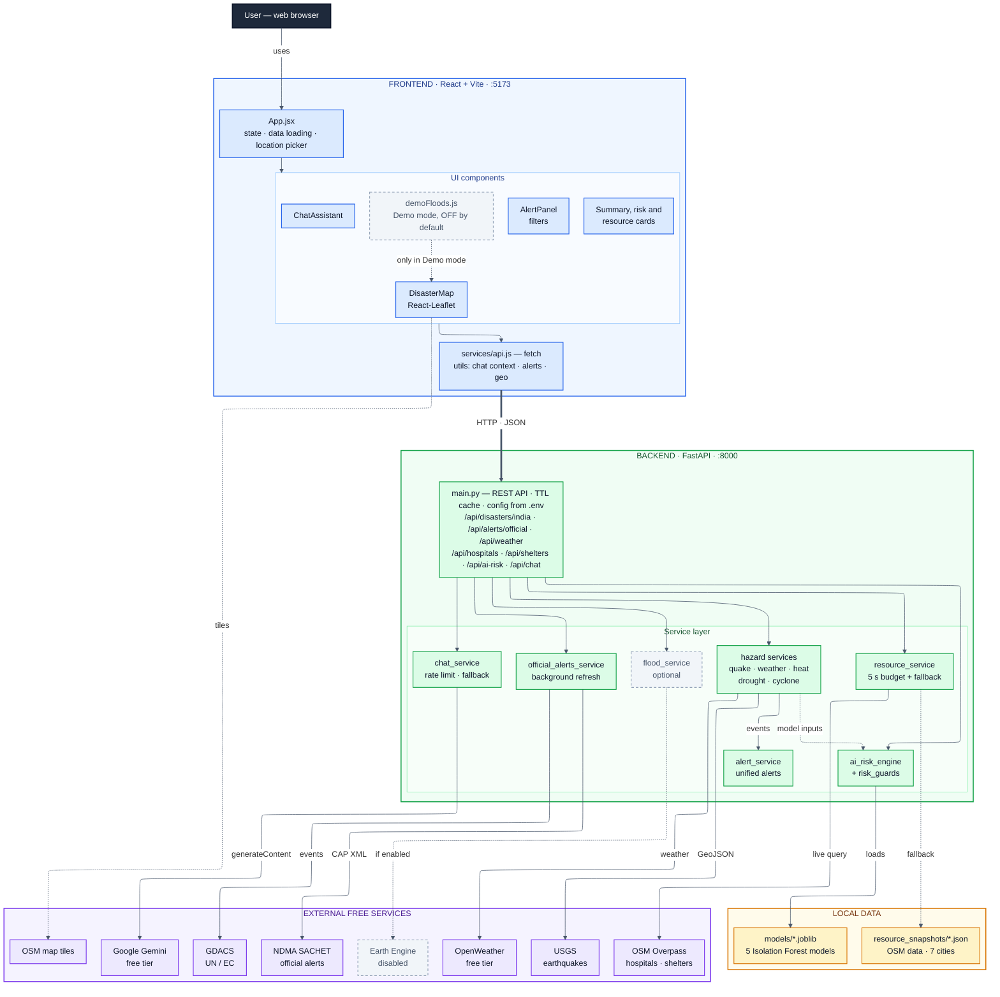

# CrisisCore 2.0 — System Architecture

Rendered image: [`CrisisCore_System_Architecture.svg`](CrisisCore_System_Architecture.svg) · [`CrisisCore_System_Architecture.png`](CrisisCore_System_Architecture.png)
(The Mermaid source below can also be pasted into https://mermaid.live to edit or re-render.)

**Legend:** blue = frontend · green = backend · amber = local data · purple = external free services ·
grey dashed = optional / disabled by default · thick arrow = HTTP/JSON between browser and API.

---

## Architecture overview

CrisisCore 2.0 is a two-tier web application:

- **Frontend (React 19 + Vite, port 5173)** — a single-page dashboard. `App.jsx` loads every data
  source independently (one failing source never blanks the page) and passes data to the map,
  alerts panel, summary/risk cards and chat assistant. The map uses React-Leaflet with OpenStreetMap
  tiles. All backend calls go through `services/api.js`.
- **Backend (FastAPI + Uvicorn, port 8000)** — `main.py` exposes REST endpoints and delegates to
  service modules. Secrets (OpenWeather and Gemini keys) are read from `backend/.env` by `config.py`.
  An in-memory TTL cache (`cache_utils`) keeps external calls within free-tier limits.
- **Local data** — five pre-trained Isolation Forest models (`models/*.joblib`) and saved
  OpenStreetMap hospital/shelter snapshots for seven cities (`data/resource_snapshots/`).
- **External free sources** — NDMA SACHET, GDACS, USGS, OpenWeather, OpenStreetMap Overpass,
  Google Gemini (free tier) and OpenStreetMap tiles. Google Earth Engine is optional and off by default.

## Major data flows

1. **Dashboard data** — the browser calls `/api/disasters/india`; the backend fetches USGS earthquakes
   and OpenWeather readings for 15 cities + 8 coastal points (in parallel, cached ~10 min), derives
   heat / drought / wind indicators, and `alert_service` turns them into a unified alert list. Each
   earthquake is tagged inside or outside India from USGS's own place name.
2. **Official warnings** — `official_alerts_service` reads the NDMA SACHET CAP feed (IMD, CWC and state
   SDMA warnings) and GDACS events, drops expired/cancelled alerts, and refreshes in the background every
   10 minutes; `/api/alerts/official` serves the cached result instantly. CAP alerts carry district names
   only, so their map position is the approximate centre of the named state (labelled "approximate").
3. **Hospitals & shelters** — `/api/hospitals`, `/api/shelters` and their `/map` (viewport) variants
   query OpenStreetMap Overpass with a 5-second budget. If live lookups fail, a circuit breaker skips live
   calls for 60 s and the nearest saved city snapshot is served, marked "saved" in the UI.
4. **Risk estimates** — `/api/ai-risk` gathers live weather and the nearest USGS earthquake, scores each
   hazard with its Isolation Forest model, then `risk_guards` caps scores that contradict observed
   conditions (IMD-style thresholds). Results are labelled "AI estimate", not official forecasts.
5. **AI assistant** — the frontend builds a factual dashboard snapshot (`utils/assistantContext.js`) and
   posts it with the question to `/api/chat`. `chat_service` applies a per-IP rate limit and calls Gemini
   with a timeout; if the key is missing, the call fails or quota is reached, it answers from a built-in
   offline safety guide.
6. **Floods** — the flood layer shows official flood warnings (SACHET/CWC), recent GDACS flood events and,
   only when Earth Engine is enabled, Sentinel-1 satellite analysis. Demo flood zones are local sample
   data shown only when the user switches Demo mode on.
